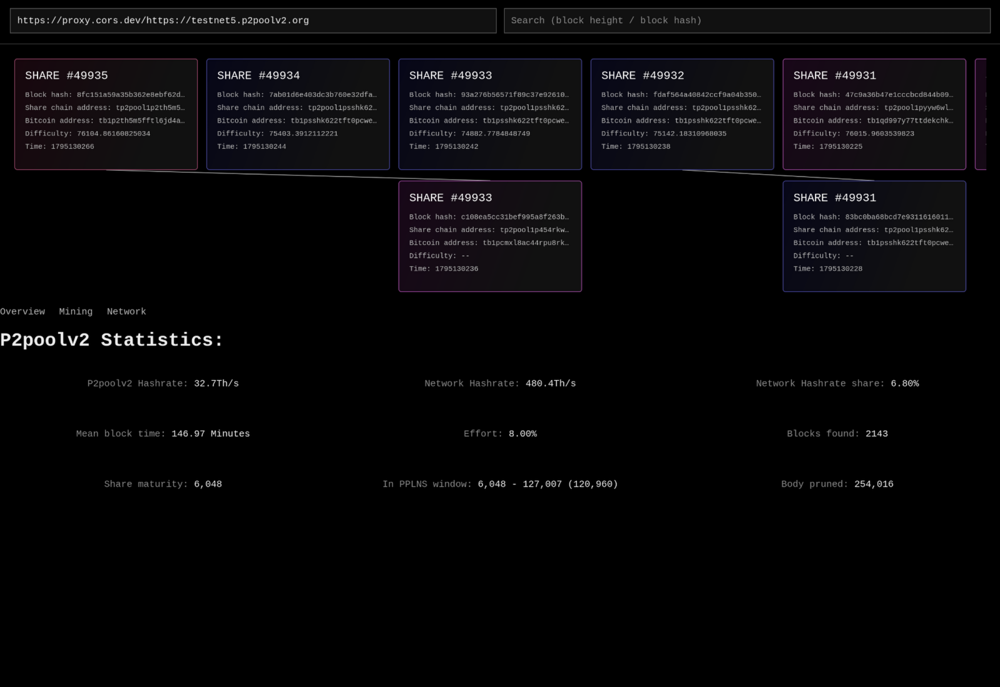
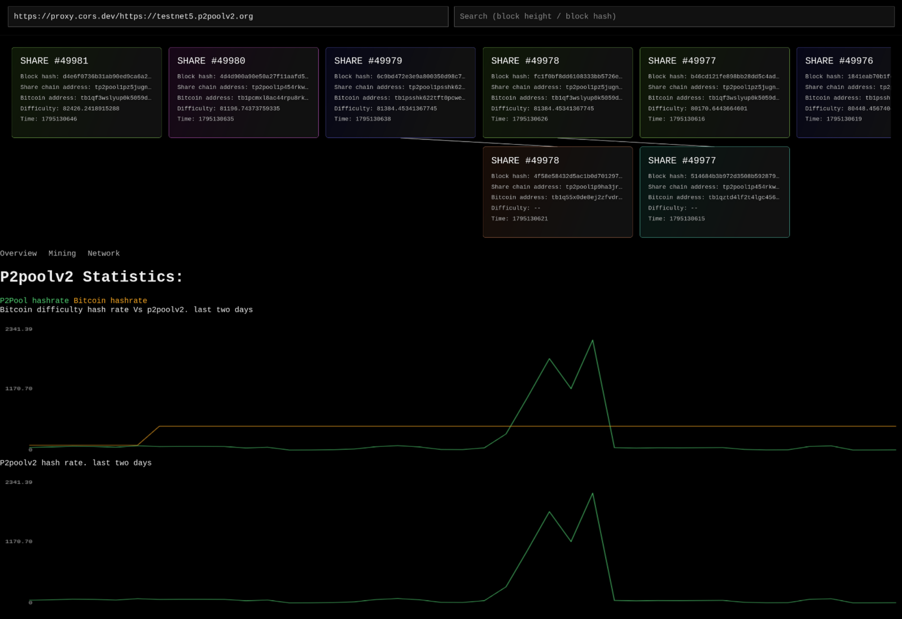
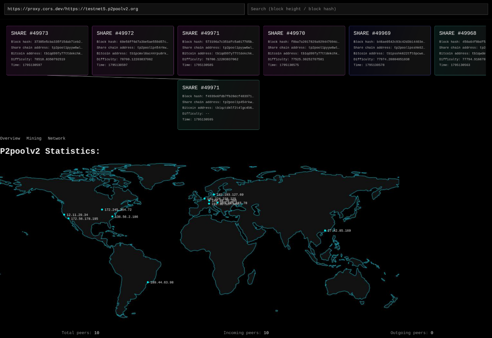

# P2Pool v2 Probe
Overview tab

Mining tab

Network tab

## Goal / mission
- To provide a lightweight HTML file to view a p2poolv2 node API feed.
## Features
- Each miner appears as a different color on the chain preview
- Click on block/share to inspect it
- All data is sourced from the node that you provide
- No backend needed

## Usage
Use our public hosting at [p2poolv2-probe.pyroforge.dev/](https://p2poolv2-probe.pyroforge.dev/), or clone the repo locally and open index.html in your preferred browser.
